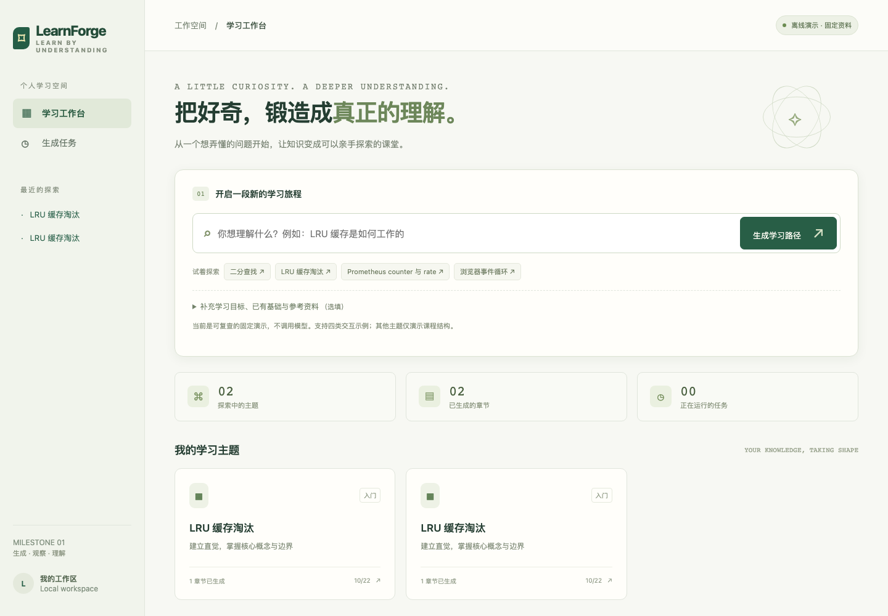

# LearnForge

一个面向个人工作区的技术自学平台。输入学习主题，编辑并确认课程大纲，再生成章节讲稿；生成脚本在受限 Worker 中执行，真实 Chromium 的反馈用于最多两轮局部修复。讲稿、教学规格、引用快照、任务与验证记录均保存版本。



## 启动

需要 Node.js **24+**（使用内置 SQLite）及 npm。macOS 已实测；其他系统需安装 Playwright 所需的系统依赖。

```sh
npm run setup
cp .env.example .env  # 如已有配置，不要覆盖
npm run dev
```

打开 [本地工作台](http://127.0.0.1:3043)。3044 是隔离预览端口。服务仅监听本机，不应直接暴露到互联网。无编译步骤，数据自动保存在 `data/`，刷新或重启可恢复。

默认 **fixture 离线演示模式**，无需密钥。二分查找、LRU、Counter 平均增量、浏览器事件循环具有固定交互；任意其他主题仅演示讲稿结构。界面会明确标识固定资料，绝不把演示称为模型生成或实时来源核验。

## 配置 OpenAI 兼容服务

在本机 `.env` 填入以下字段；不要把密钥提交 Git 或发到聊天：

```dotenv
PROVIDER=openai
API_KEY=你的密钥
MODEL=你的服务支持的模型标识
MODEL_BASE_URL=https://api.openai.com/v1
# 其他兼容服务填写其 /v1 或对应 API 根路径，系统追加 /chat/completions
MODEL_TOKEN_FIELD=max_completion_tokens
```

使用 Chat Completions JSON mode，并在服务端用 Zod 校验结果。不支持 `max_completion_tokens` 的服务可设置 `MODEL_TOKEN_FIELD=max_tokens`。Schema 最多两次生成/修正，受同一调用与 Token 预算约束。实际模型 ID 和用量会记录，无法获取的费用显示“未知”。不会通过 Codex 订阅自动获取 API 密钥。

可选配置 `SEARCH_API_KEY`（Brave Search）以启用真实搜索；无搜索密钥时，创建主题时填写公开 HTTPS 参考链接，仍可实际读取正文。搜索片段不会当成已读取资料。版本识别失败会如实标注“未自动识别”。**保存 `.env` 后需重启服务**。用 `npm run doctor` 检查是否已配置，不输出密钥。

## 使用流程

1. 输入主题，可补充目标、基础、深度、版本和参考链接。
2. 在主题工作台编辑章节标题、目标、前置知识、知识点，调整顺序后确认。
3. 选择章节生成；任务依次进行规格规划、HTML 生成、真实浏览器验证与有限修复。
4. 阅读讲稿、操作交互、查看四层验证、来源快照及桌面/移动截图。
5. 通过局部修改创建新版本；可切换旧版本、取消任务或创建关联重试。修改学习目标不会覆盖已有讲稿。

## 检查与评测

```sh
npm test                  # Schema、SSRF、持久化、幂等、恢复等单元回归
npm run check             # 源文件语法
npm run test:integration  # 自启动本地模拟模型服务；真实 HTTP/修复/版本/队列联调
npm run test:security     # Chromium + SES 逃逸、死循环与恢复
npm run test:e2e          # 需先启动工作台；完整桌面/移动 UI 流程，录制视频
npm run eval              # 22 个固定夹具 + 故障注入，真实浏览器 A/B 工程评测
npm run eval:live         # 需真实模型配置；20 个固定资料案例的模型生成/修复评测
npm run eval:e2e          # 需真实模型及搜索配置；同批案例使用真实搜索和正文读取
```

运行 `eval` 不调用模型，与 `.env` 的生成模式无关。`eval:live` 不会在缺少密钥时退化为夹具。评测单独存储，不污染个人工作台。所有评测顺序执行；普通应用同一时间只运行一个任务。测试使用独立数据库；UI 测试会在本地个人空间创建演示主题。

- [本批工程评测报告](docs/evaluation.md)：22 案例，保留失败，不代表真实模型质量收益。
- [完整原始工程结果](docs/evidence/results.json)、[案例输入与人工审查项](eval/cases.json)。各案例的初始/最终 HTML 和独立报告位于 `docs/evidence/cases/`；重跑产生的全部截图位于 `artifacts/evaluation/`。
- [架构与安全边界](docs/architecture.md)、[PRD 验收映射与未完成门槛](docs/acceptance.md)、[API](docs/api.md)。
- 演示视频：运行 `test:e2e` 后位于 `artifacts/demo/*.webm`，仓库附带 [Demo 视频](docs/media/demo.webm)。

## 当前交付边界

已实现 M1 的产品与工程闭环，实测环境为 macOS arm64、Node 24.17.0、Chromium 156.0.8078.4，桌面 1280/1440px 与移动 375/390px。

**尚未完成 PRD 的全部发布验收**：当前未配置真实模型或搜索密钥，真实模型 A/B、真实搜索端到端评测、独立人工引用/内容审查和盲测保留集尚未运行。夹具修复只是展示反馈管线，不能据此声称 AI 生成质量提升。提供了接入与评测命令，运行后会生成独立报告。

预览仅支持受限 HTML/CSS 和虚拟控件 DOM：不支持包安装、Canvas、任意 DOM、后端程序或真实集群。暂不包含 M2/M3 的练习、复习和音频；不会自动创建这些任务。

## 资料

适配实现参考 [Chat Completions 官方 API](https://developers.openai.com/api/reference/resources/chat/subresources/completions/methods/create)、[Playwright 网络隔离](https://playwright.dev/docs/network)、[SES 官方说明](https://github.com/endojs/endo/blob/master/packages/ses/README.md) 与 [Node SQLite](https://nodejs.org/api/sqlite.html)。这些资料描述底层能力，不构成本产品质量验收结果。
