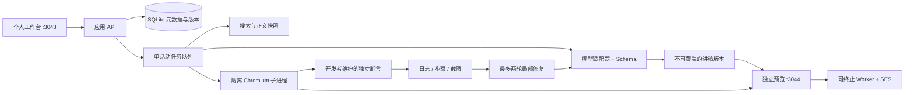

# 架构与取舍

M1 使用原生浏览器模块前端、Express 应用服务、SQLite、顺序编排 Worker、独立预览端口、SES/浏览器 Worker 和 Playwright。无构建脚本、外部前端包或云端 IDE。原生前端足以承载稳定阅读布局；后续复杂编辑器可以迁移 React，不影响 API 和数据契约。

## 任务与版本

`server/jobs.js` 管理排队、运行、成功、部分成功、失败与取消。入队保存主题设定快照；规格规划完成后，渲染、验证、修复关联同一份经 Schema 校验的规格。模型只输出内容和代码，不能修改评测规则、任务预算或数据库。不同请求 ID 的重试关联原任务，原错误证据保留。

生成与修复逐版保存 HTML、规格、父版本、来源 ID 及独立验证报告 ID。新版本从未沿用旧报告。修复记录包含输入证据、输出版本、报告与回归项。达到修复次数、耗时、调用、Token 任一预算时停止。用户取消通过 AbortController 传递到读取、模型 HTTP 和浏览器子进程。

SQLite 使用 WAL，单进程写入，JSON 记录按 kind 索引；关系用稳定 ID 表达。M1 个人空间规模采用此结构，避免过早引入分布式队列。启动时把中断的运行任务标为失败，要求主动重试，避免自动重放计费调用；未执行的排队任务恢复执行。多实例部署需迁移事务领取、租约与所有者权限，当前不支持。

## 生成内容隔离

1. 预览使用独立端口与 `sandbox allow-scripts` 的不透明来源；主站没有向预览传递密钥、会话或存储内容。
2. Cheerio 解析生成 HTML，提取脚本作为数据，移除原脚本、事件属性、表单、导航、SVG、iframe、外部资源与未知标签。响应 CSP 使用随机 nonce，仅运行可信宿主，默认禁止网络、表单和嵌套框架。
3. 所有生成脚本在 **Web Worker 内的 SES Compartment** 执行。仅授予虚拟 document，不授予 fetch、XMLHttpRequest、location、window、postMessage、存储、计时器或真实 DOM。
4. 虚拟控件仅支持 `querySelector`（ID、class、标签或 data-testid）、`querySelectorAll`、`getElementById`，以及节点的 value/textContent/disabled、click/input/change 事件。受限接口不会返回原始 Node、事件或 ownerDocument。
5. 可信宿主将受限状态更新应用到静态教学 DOM。Worker 初始化或一次操作超过 1.5 秒即终止，页面保留文字解释，可重新创建预览。SES 本身不防 CPU 耗尽，终止边界由浏览器 Worker 实现。
6. 浏览器验证另外采用无凭证进程、全新 context、禁用 Service Worker、仅放行初始预览请求的路由和 20 秒墙钟看门狗。工作进程不继承模型环境密钥。
7. 主站验证消息同时校验 iframe 窗口、null 来源、随机 token、版本 ID、消息结构与状态枚举。没有凭消息写入“验证通过”的 API。

HTML 下载不会作为主站同源 HTML 执行；截图接口只返回固定 PNG。CSP 的 unsafe-eval 仅存在于预览的可信 SES 宿主，用于在隔离 Compartment 内求值；主站没有该权限。

这些限制有意牺牲任意 Web 应用兼容性。不支持的 DOM/依赖触发验证失败与有限修复，最终部分交付。依赖升级必须重新执行安全与浏览器回归；此实现没有经过第三方安全审计。

## 资料与 SSRF

仅允许无 URL 凭证、默认端口的公开 HTTPS 地址。每次读取及重定向都解析全部 DNS 结果，拒绝私网、回环、链路本地、IPv4 映射 IPv6、多播与保留地址，并把连接钉到已校验 IP。跨源重定向不转发搜索密钥。读取限 12 秒、1.5MB、3 次重定向，正文取 24,000 字符；不执行网页脚本，不安装包。

搜索片段仅用于选择 URL。实际正文、读取时间、SHA-256、来源类型、版本识别状态独立记录。无法识别版本、来源读取失败、固定开发摘要都有独立状态。候选官方来源类型仅是启发式标签，人工仍需审核。来源缓存与检索缓存 TTL 可配置。

资料作为模型输入的数据，不进入系统指令。提示注入风险通过最小工具权限与确定性策略约束，不能仅靠提示词消除。

## 检查职责

运行、交互、独立技术规则、呈现是四个独立层。规则保存在 `eval/reference.js` 和 `scripts/browser-worker.js`，模型服务无法修改。二分、精确 LRU、重置感知平均增量、简化事件顺序有独立断言；开放主题仅进行运行、控件和布局检查，标记语义未自动验证。

移动呈现检查标题可见、正文非空和横向溢出，不能替代全面可访问性审查。Counter 演示不实现 Prometheus 的窗口外推；LRU 不模拟 Redis 的近似淘汰；事件循环不模拟渲染与 Node.js 队列。

## 数据生命周期

本地数据库和产物位于 `data/`，不纳入 Git。删除主题会清理大纲、讲稿、任务、来源、验证与截图；活动任务须先取消。启动时依据 `RETENTION_DAYS` 清理过期截图、磁盘代码副本、浏览器步骤日志、任务事件及正文快照（记录过期标记），数据库的讲稿版本仍保留到用户删除。不要在本机 Demo 中放入敏感资料。

本次只实测单机顺序任务，不宣称高并发或学习效果。真实供应商费用未知时保持 null，不根据 Token 数捏造金额。
